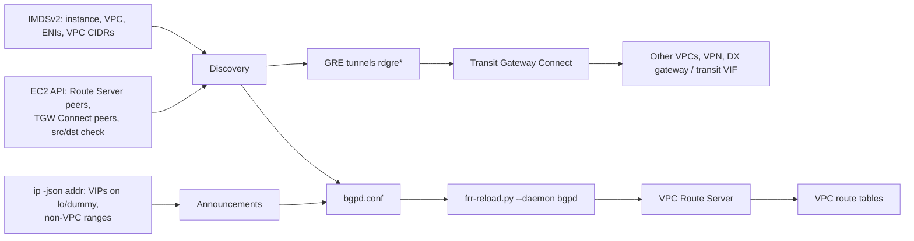

# Zero-configuration BGP to AWS

`route-discovery bgp run --apply` peers this instance with AWS's own BGP speakers and announces the service addresses on its interfaces. There is no configuration file and no overlay between instances: AWS's managed routers carry the routes between VPCs, Transit Gateway, VPN and Direct Connect.



## What it discovers

Every 15 seconds it does the following:

1. **Reads this instance from IMDSv2:** its ID, region, VPC, VPC CIDRs, and every ENI with its addresses.
2. **Finds the peerings that name this instance.**
   - **VPC Route Server peers** whose peer address is one of this instance's ENI addresses. The neighbor is the route server endpoint's ENI address, the remote ASN is the route server's Amazon-side ASN, and the local ASN is the peer's ASN. BFD is enabled when the peer's liveness detection is `bfd`.
   - **Transit Gateway Connect peers** whose GRE peer address is one of this instance's ENI addresses. Each one gets a GRE tunnel (`rdgre<id>`) with the inside address, plus both TGW BGP sessions with eBGP multihop 2.
   - Peers in another VPC, or not yet `available`, are listed under `ignored`.
3. **Chooses what to announce.** These are addresses on local interfaces that fall outside every VPC CIDR, typically service VIPs on `lo` or a `dummy` interface, or a non-VPC range. An address inside a VPC CIDR is already reached by the VPC local route, so it is withheld. Container and bridge interfaces are excluded, as in the mesh mode. If an address is removed, its `network` statement goes too, and FRR's import check withdraws it.
4. **Checks source/destination checking** on each Route Server peer's ENI. While it is enabled, EC2 drops traffic addressed to the announced VIPs. Announcing then would black-hole traffic, so that neighbor gets a deny-all export, and status reports why.

## Routing policy

- **Export:** exactly the announced prefixes.
- **Import:** everything except this VPC's own CIDRs. A learned VPC route via the TGW would otherwise capture intra-VPC traffic. This instance's announced prefixes are also rejected. A default route is accepted unless `--no-default-route` is set.
- **ECMP:** `maximum-paths 4` (configurable), so both TGW Connect sessions carry traffic.

## How each AWS construct fits

| Construct | Path |
| --- | --- |
| VPC route tables | Route Server propagates selected routes into associated tables. Use two or more instances announcing the same VIP for failover. BFD or BGP keepalive liveness withdraws a failed instance. |
| Transit Gateway | Connect sessions receive the TGW route table's routes (other VPCs, VPN, Direct Connect gateway) and inject announced VIPs into it. |
| VGW / Site-to-Site VPN | AWS-managed. Routes reach this instance through the TGW when the VPN is a TGW attachment. For a VGW on a VPC, enable route propagation on the tables; Route Server routes and VGW routes then coexist under AWS route priority rules. |
| Direct Connect private VIF / transit VIF | AWS-managed, through the VGW or DX gateway and TGW. This mode does not run on the on-prem router that terminates the VIF. |
| PrivateLink | Not routed. Interface endpoint IPs sit inside the consumer VPC CIDR and are reachable wherever that VPC CIDR is routed. VPCs with overlapping CIDRs cannot be joined by routing. |

## Self-registration

With `--register`, the instance creates its own Route Server peers. It pairs every `available` route server endpoint in the VPC with the primary IPv4 address of this instance's ENI in the same subnet. A launched instance therefore joins Route Server with no per-instance IaC, and a new subnet endpoint is picked up on the next pass.

- **Ownership tag.** Peers it creates are tagged `route-discovery:owner=<instance-id>`. Only peers with this instance's tag are ever deleted, so operator-created peers are left alone and still used.
- **Cleanup.**
  - An owned peer is deleted when its endpoint disappears, the ENI address changes, or the peer goes `failed`.
  - A failed peer is recreated on a later pass, after AWS reports it deleting.
  - `bgp withdraw --apply` brings the BGP sessions down first, then deletes every owned peer.
- **Pending peers.** A new peer is `pending` at first. Status stays unconverged until a later pass discovers it as `available` and bgpd establishes the session.
- **ASN and liveness.** The local ASN comes from `--register-asn` (default 65001) and must differ from the route server's ASN; endpoints where they match are listed under `ignored`. Liveness comes from `--register-liveness bfd|bgp-keepalive` (default `bfd`, which needs `bfdd`).
- **Permissions.** Add [`deploy/bgp-aws-register-policy.json`](../deploy/bgp-aws-register-policy.json). It allows creating peers only with the owner tag and deleting only tagged peers. The tag value is not bound to the calling instance, so any instance with this role can delete another's tagged peers. Validate the condition keys in a staging account before production.
- **Terminated instances.** With `--sweep`, each instance also cleans up after others. It looks up the owners of every tagged peer in its VPC and deletes the peer once that owner is terminated, shutting down, or no longer known to EC2.
  - Peers of stopped instances are kept, because a stopped instance can start again.
  - Untagged peers, peers in other VPCs and the instance's own peers are never swept.
  - A peer must stay orphaned for 5 minutes before deletion. DescribeInstances is eventually consistent, so a just-launched instance can briefly look absent, and its owner reappearing resets the clock.
  - Several instances may sweep the same peer. A failed delete is reported in status and retried next pass; it does not fail the pass.
  - Sweeping needs `ec2:DescribeInstances` and the tagged-delete permission, both in the registration policy. `bgp withdraw --apply` from a shutdown or lifecycle hook remains the faster path.
  - Status lists candidates under `orphans`, and `bgp_orphaned_peers` counts them. Without `--apply`, deletions are only logged.

## Prerequisites

The remaining peering resources must already exist, created through IaC or the console:
- A Route Server associated with the VPC, with endpoints in the instance's subnets and propagation enabled on the route tables.
- Without `--register`, a peer resource for this instance's address.
- For Connect: a Connect attachment and Connect peers whose peer address is this instance's ENI address, with a TGW CIDR block routed to the TGW attachment in the instance's subnet route table.

On the instance you also need:
- FRR with `bgpd=yes` (and `bfdd=yes` for BFD) and `frr-reload.py`, plus the IAM permissions in [`deploy/bgp-aws-policy.json`](../deploy/bgp-aws-policy.json).
- Source/destination checking disabled on Route Server peer ENIs.
- Security groups allowing TCP 179 and UDP 3784–3785 to and from Route Server endpoints, and IP protocol 47 to and from the TGW CIDR block.

## Ownership

This mode owns FRR's **bgpd** configuration: `frr-reload.py --daemon bgpd` removes any bgpd line that is not in the generated file. It also owns interfaces named `rdgre*`. Reloads happen when the generated configuration changes, and at least every 5 minutes to revert manual drift. When the process stops, bgpd keeps its sessions and announcements. `bgp withdraw --apply` removes the peerings and tunnels.

## Commands

```bash
route-discovery bgp discover          # instance, peerings, tunnels, announced/withheld prefixes (JSON)
route-discovery bgp render-frr        # the bgpd configuration
route-discovery bgp plan              # tunnel commands and frr-reload --test output
route-discovery bgp run               # dry-run controller
route-discovery bgp run --apply
route-discovery bgp run --apply --register --register-asn 65001 --sweep
route-discovery bgp withdraw --apply
route-discovery status --url http://127.0.0.1:9811/status
```

Optional flags: `--register`, `--register-asn`, `--register-liveness`, `--sweep`, `--include`/`--exclude GLOB`, `--no-default-route`, `--maximum-paths`, `--frr-reload PATH`, `--vty-socket DIR`, `--interval` (at least 5 s), `--listen`, `--port` and `--state-dir`.

Status is `ready` when every discovered neighbor is Established and no neighbor is gated.

## Not implemented

- Creating Connect peers for the instance. Connect peers need inside CIDRs allocated per attachment, which belongs in IaC.
- Cross-account discovery.
- BGP MD5 or TCP-AO.
- The on-prem Direct Connect router role.
