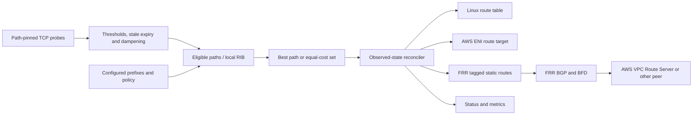

# Design and deployment validation

The daemon separates path observation, local route selection and forwarding control. A destination is a canonical prefix with one or more configured candidate next hops. Each candidate has independent probe paths and a rank. There is no automatic inventory discovery or arbitrary route import into the local policy engine.

## Selection and timing

Each candidate's endpoints run concurrently. A sample passes when the configured quorum succeeds. One failed sample does not withdraw an established path unless `failures = 1`. A path becomes healthy after `successes` consecutive passing samples. If a path stops producing samples, it expires after `stale_after`; a later success must rebuild its success streak.

Only administratively enabled, healthy, unsuppressed paths without the configured local ASN in their policy AS path are eligible. Rank is `(-local_pref, AS-path length, MED, cost)`. Existing equal-ranked paths are preferred to avoid tie churn, followed by a deterministic identifier. The best equal-ranked set is capped by `max_paths`. This is an explicit subset of BGP-inspired policy, not RFC 4271 best-path conformance.

When an active path fails, selection immediately considers all eligible alternatives. When an active path remains healthy, a recovered candidate must remain healthy for `failback_delay` after reaching UP before preemption. `preempt = false` retains surviving active paths until they fail; it does not refill a surviving ECMP set with new paths.

With interval I, timeout T, failure threshold F and reconciliation interval R, detection under normal scheduling is approximately `(F-1)*I + T` to `F*I + T`, followed by up to about `1.1*R` plus route-write/convergence time. Route-path validation subprocesses and scheduling add overhead. Retry backoff can add up to 33 seconds; API/SDK calls can add more. These are estimates, not SLA bounds. Probe work continues independently of backend failures. Writes are serialized across prefixes, so one slow backend operation can delay other prefix updates but does not block probes.

A transition from UP to DOWN adds a penalty. Penalties decay by half every configured half-life; the suppress threshold makes a path ineligible until the reuse threshold or maximum suppression duration is reached. Checkpoints persist penalties and suppression age only. A healthy state is never restored from disk. TCP can report an endpoint healthy even when some other service or traffic class is broken; choose probe endpoints accordingly.

## Ownership and consistency

| Plane | Ownership boundary | Verified outcome |
| --- | --- | --- |
| Linux | Exact prefix, configured table, numeric protocol and metric; only configured next hops | Kernel route JSON matches desired paths/type |
| AWS | Tagged table, explicit prefix, static route, configured ENI allowlist | DescribeRouteTables shows desired target and active state |
| FRR | Exact configured global static command with reserved tag; foreign statics for that prefix block changes | Running configuration contains selected tagged statics |

Linux replacement is one `ip route replace` operation per prefix. FRR adds new next hops before deleting old ones; short-lived multipath is possible. AWS does a read, write and readback; an eventually consistent response stays pending and is reconciled later. There is no multi-prefix transaction, distributed fencing or rollback of arbitrary administrator changes. External writers must be excluded; read-before-write checks cannot eliminate their races.

The state-directory advisory lock is local. All processes managing the same plane must use the same state directory. It does not coordinate separate hosts. Provisioning and high availability of an AWS control plane are deliberately delegated to AWS Route Server/FRR when required.

No automatic table flushing, default route adoption, ENI creation, subnet association, security-group editing or source/destination-check changes occur. Shutdown retains Linux/AWS routes; FRR runtime statics are withdrawn on orderly exit and by systemd's post-stop cleanup. An unavailable FRR socket can prevent cleanup. Monitor the service and BGP/FIB state, not just the daemon's liveness.

## Staging checklist

1. Choose Linux overlay routing, FRR plus BGP, or single-writer EC2 API routing. Identify all destination prefixes and permitted next hops. Record the rollback configuration and existing routes.
2. Build independent forward and return paths through at least two failure domains. On AWS verify appliance ENI/subnet constraints, disabled source/destination checking, IP forwarding, security groups, NACLs and MTU.
3. Validate TOML. Reserve probe tables/marks/priorities and route protocol/tag identifiers. For Linux/FRR inspect the generated probe script, provision it, then run `check-paths`. For AWS independently prove each external probe traverses only its declared candidate, including after route replacement.
4. Stop one probe endpoint without stopping the appliance. Confirm application-path failure causes the intended failover and that traffic reaches the backup. Keep primary probes pinned while it is inactive.
5. Restore the endpoint. Measure recovery thresholds and hold-down, then verify traffic returns to the preferred path. Repeat intermittent failures and check suppression/decay.
6. Fail every path. Verify `withdraw`, `retain` or `unreachable` matches the intended fallback. Check overlapping prefixes, IPv6, default routes and management/SSH reachability.
7. Deny an AWS operation, simulate API throttling or stop FRR. Confirm status remains unconverged, probes continue and updates recover without claiming failed writes succeeded. Check CloudTrail/FRR logs for actual effects.
8. Restart and kill the daemon. Verify dampening persistence, fresh health assessment, service watchdog behavior and FRR post-stop withdrawal. Never persist transient health-dependent FRR statics to disk.
9. For BGP, verify real neighbors, BFD sessions, inbound/export filters, advertised attributes, remote selected routes and both AWS route-server endpoints. Validate AWS Route Server support/quotas for the selected region at deployment time.
10. Measure disruption under realistic load, connection state loss, asymmetric routing, probe scheduling jitter and scale. Tune timers only after measuring. This implementation uses subprocess-based Linux path verification and is not a high-rate BFD packet engine.

## Scope for future work

The separate [route-server mode](route-server.md) now supports dynamic BGP route learning and propagation into multiple VPC tables. The original host/appliance mode still uses configured candidates. A distributed controller with fencing, integrated tunnel provisioning, authenticated application probes, atomic configuration reload, adaptive path scoring and automatic FRR process management are not implemented. FRR supplies the routing protocol machinery.
