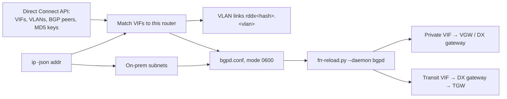

# Direct Connect router role

`route-discovery dx run --apply` runs on the on-prem Linux router that terminates Direct Connect virtual interfaces. It reads this router's private and transit VIFs from the Direct Connect API, brings up their VLAN interfaces, and peers BGP with AWS on every one. Each session gets the ASNs, addresses and MD5 key AWS already holds for that VIF. The router's on-prem subnets are announced. AWS carries them to the virtual private gateway, Direct Connect gateway or Transit Gateway behind each VIF, and sends VPC and other AWS routes back.



## Which VIFs are this router's

A VIF is matched in either of two ways:

- **Addressed already:** one of its BGP peers' customer addresses is configured on a local interface. This covers VLANs set up by netplan, NetworkManager or ZTP, and needs no flags.
- **Mapped port:** its connection or LAG is mapped to a local parent interface with `--parent eth1=dxcon-abc123` (or `=dxlag-…`). The role then owns a VLAN interface `rddx<hhhh>.<vlan>` on that parent, where `hhhh` is a stable hash of the parent's name (for example `rddxf006.102` on `eth1`). Redundant connections on different ports can therefore use the same VLAN ID. It sets the VIF's VLAN ID, MTU (1500 or jumbo 8500/9001) and customer addresses, and recreates the interface if the parent or VLAN changes.

The physical port behind a connection can't be discovered from the router: Direct Connect doesn't expose LLDP. That's why `--parent` is the one optional input. Without it, nothing is provisioned.

Matched VIFs are skipped, with the reason shown in status, when:
- they are public VIFs, which carry AWS's public prefixes and need public address space you own;
- they are not `available` or `down`;
- another VIF on the same parent already uses that VLAN; the first one keeps it.

Unmatched VIFs in the account are ignored silently.

## Sessions

Each IPv4 and IPv6 BGP peer on a VIF becomes a neighbor:
- **ASNs:** the VIF's Amazon-side ASN is the remote ASN. The peer's customer ASN is the local ASN, using `local-as` when VIFs disagree.
- **MD5:** the VIF's MD5 key, when it has one.
- **BFD:** enabled; disable with `--no-bfd`. It needs `bfdd`.
- **ECMP:** `maximum-paths 4` across redundant VIFs.

## What gets announced

The router announces connected subnets on its up interfaces, plus any `--announce PREFIX` aggregates (each needs a matching route in the RIB, for example from the on-prem IGP or the mesh role). These are never announced:
- VIF peering links;
- `rddx*` links;
- loopback and link-local addresses;
- container and bridge interfaces (the same exclusion list as the other roles; adjust with `--include`/`--exclude`).

AWS accepts at most 100 prefixes per address family on a private or transit VIF, and idles the session beyond that. If there are more, the role announces nothing on any VIF and reports why. That keeps the sessions up, so AWS routes still reach on-prem. `maximum-prefix-out 100` is also set as a backstop. Use aggregates or `--exclude` to get under the limit.

## Import policy

- Accepted: everything AWS advertises, except this router's own announced space.
- The default route is rejected unless `--accept-default-route` is given.
- Learned routes are installed in the kernel by zebra. Redistributing them into an on-prem IGP is up to that IGP's configuration.

## Credentials and secrets

There is no instance role on-prem. Use the standard AWS credential chain: environment variables, or a profile with `credential_process`, such as IAM Roles Anywhere. The systemd unit reads `/etc/default/route-discovery-dx` for `AWS_*` variables and optional `DX_ARGS`. Grant [`deploy/dx-aws-policy.json`](../deploy/dx-aws-policy.json), which is `directconnect:DescribeVirtualInterfaces` only.

That API call returns the VIFs' BGP MD5 keys. Treat its permission, the credentials, `bgpd.conf` and FRR's running configuration as secrets. The role keeps the keys out of logs, status and `discover` output, and writes `bgpd.conf` with mode 0600. `render-frr` prints them, because it shows the full configuration.

## Ownership

This role owns bgpd (`frr-reload.py --daemon bgpd` removes lines not in the generated file) and interfaces named `rddx*`. It can't share an FRR instance with the `bgp` role, but it can run beside the `mesh` role, which owns babeld. When the process stops, bgpd keeps its sessions. `dx withdraw --apply` removes the sessions, then the VLAN links.

## Commands

```bash
route-discovery dx discover                       # VIFs, links, announced/withheld prefixes (no keys)
route-discovery dx render-frr                     # bgpd configuration, including MD5 keys
route-discovery dx plan                           # VLAN commands and frr-reload --test output
route-discovery dx run --apply --parent eth1=dxcon-abc123 --region eu-west-2
route-discovery dx withdraw --apply
route-discovery status --url http://127.0.0.1:9812/status
```

Optional flags: `--region` (repeatable), `--parent IFACE=DXCON` (repeatable), `--include`/`--exclude`, `--announce PREFIX`, `--accept-default-route`, `--no-bfd`, `--maximum-paths`, `--frr-reload PATH`, `--vty-socket DIR`, `--interval` (default 30 s, minimum 10), `--listen`, `--port` and `--state-dir`.

Status is `ready` when every discovered VIF neighbor is Established and announcements are not withheld.

## Not implemented

- Public VIFs.
- Hosted VIFs owned by another account; they appear only in the owning account's API.
- AS-path prepending or communities for active/standby VIF preference.
- MACsec.
