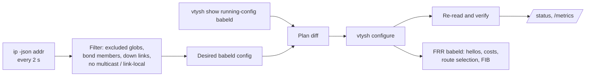

# Zero-configuration mesh

`route-discovery mesh run --apply` turns every eligible NIC on a host into a Babel (RFC 8966) interface in FRR and publishes the host's connected subnets. There is no configuration file. Each host discovers its neighbours by multicast hellos on each link, costs the links, floods its prefixes and installs loop-free shortest paths. A second NIC means a second path; a failed NIC, cable or host means Babel reroutes around it.



The daemon is a configuration reconciler. FRR does all wire-protocol work. If the daemon stops, babeld keeps routing with the last applied configuration. Exiting does not withdraw it.

## What gets published

An interface joins the mesh when all of these hold:

- it does not match an exclusion glob (`lo`, `docker*`, `br-*`, `veth*`, `virbr*`, `cni*`, `flannel*`, `cali*`, `vxlan.calico`, `kube-*`, `cilium*`, `lxc*`, `podman*`, `tap*`), or `--include` is given and it matches;
- it is not a bond/bridge member (the aggregate is used instead);
- it is up, with carrier, and has the `MULTICAST` flag;
- it has an IPv6 link-local address, which Babel requires for its hellos.

Its global and private subnets are advertised. Loopback, IPv4 link-local (169.254/16) and IPv6 link-local addresses are never published, but a link that has only such addresses (for example a VTI tunnel) still carries Babel traffic. Wireless interfaces (those with `/sys/class/net/<name>/wireless`) get `babel wireless`; all others get `babel wired`.

Subnets on skipped interfaces are *withheld*: the outbound filter denies them explicitly. Without that, `redistribute connected` would leak Docker or Kubernetes bridge subnets into the mesh.

## Filters

| Filter | Contents |
| --- | --- |
| Inbound | permit `--accept` supernets (default `10/8`, `172.16/12`, `192.168/16`, `100.64/10`, `fc00::/7`), deny everything else |
| Outbound | deny withheld subnets, permit local published subnets, permit `--accept` supernets (transit for other hosts), deny everything else |

A default route is never accepted or relayed. Choose `--accept` to cover the mesh's address space; published subnets outside it reach direct neighbours only.

Filters are double-buffered: the daemon writes a complete `RDM-<IN|OUT>-V<4|6>-<A|B>` prefix list, points the `distribute-list` at it, then deletes the previous one. Babel never evaluates a partial filter.

## Ownership

This mode owns FRR's `router babel` `network` and `redistribute` lines, its four `distribute-list` lines, and every `RDM-*` prefix list. `network` lines for interfaces the inventory does not select are removed. On selected interfaces it sets `babel wired|wireless`, `babel hello-interval` and `babel update-interval`, and leaves other interface settings alone. Do not manage Babel by hand on the same FRR instance.

If FRR's running config does not reflect a plan after it is applied, status stays unconverged and the same plan is not replayed until the inventory changes or FRR's state moves.

## Security

FRR babeld does not implement Babel HMAC authentication (RFC 8967). Any host that can send link-local multicast on a meshed interface can inject routes within the accept supernets. Mesh only trusted segments, or run Babel over authenticated, encrypted links such as WireGuard or IPsec, and use `--include` or `--exclude` to keep untrusted NICs out. The inbound filter limits *what* can be injected, not *who* can inject it.

## Cloud networks

AWS, Azure and GCP VPC fabrics do not forward link-local multicast, so Babel cannot form adjacencies directly across them. With `--registry s3://bucket/prefix`, the mesh builds GRE tunnels between hosts and runs Babel over them; see [GRE overlay](overlay.md). On EC2, Babel then runs only on the tunnels.

## Commands

```bash
route-discovery mesh inventory            # what would be meshed, skipped and withheld (JSON)
route-discovery mesh render-frr           # full babeld fragment for review or frr.conf
route-discovery mesh plan                 # vtysh commands to reconcile the running FRR
route-discovery mesh run                  # dry-run controller; logs plans, writes nothing
route-discovery mesh run --apply          # reconcile continuously
route-discovery mesh withdraw --apply     # remove the babeld instance and RDM-* filters
route-discovery status --url http://127.0.0.1:9810/status
```

Overlay flags, all needing `--registry`: `--registry-region`, `--platform auto|ec2|metal`, `--site`, `--endpoint`, `--relays` (default 2), `--registry-interval` (default 60 s) and `--tunnel-mtu` (default 1476).

Optional flags: `--include`/`--exclude GLOB` (repeatable), `--accept PREFIX` (repeatable; replaces the defaults), `--hello-interval-ms` (default 1000), `--update-interval-ms` (default 4000), `--vty-socket DIR`, `--interval` (seconds between passes, default 2), `--listen`, `--port` (default 9810) and `--state-dir`.

Babel detects a lost neighbour after a few missed hellos; at a 1 s hello interval, expect seconds, not milliseconds. Babel's own link-quality estimate decides path cost.

## Prerequisites

FRR with `babeld=yes` in `/etc/frr/daemons`, `zebra` running, IP forwarding enabled (`net.ipv4.ip_forward=1`, `net.ipv6.conf.all.forwarding=1`) where hosts relay traffic, and the service user in `frrvty`. Firewalls must allow UDP 6696 to and from `ff02::1:6` and link-local addresses on meshed interfaces.
