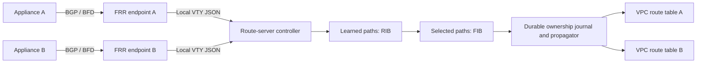

# BGP-to-VPC route-server mode

Version 0.2 adds a self-hosted route server alongside the original health-driven routing daemon. Appliances advertise IPv4/IPv6 routes over BGP to FRR endpoints. The controller reads all accepted paths, checks BGP/BFD state, selects a FIB from its RIB, and propagates ENI targets to multiple VPC route tables. This implements the core workflow described in [AWS Route Server operation](https://docs.aws.amazon.com/vpc/latest/userguide/route-server-how-it-works.html).

It is not an AWS API-compatible replacement or an AWS-managed multi-AZ service. EC2 API updates produce **static routes**, with static-route priority, rather than native Route Server propagation entries. Endpoint polling and EC2 API latency do not provide native-service convergence guarantees.



The controller is outside the traffic path. The original daemon can still run on appliances to add/withdraw FRR statics based on end-to-end probes; route-server mode consumes their advertisements. BGP/BFD liveness alone does not prove destination application health.

## Functionality

| Capability | Implementation |
| --- | --- |
| VPC association | Explicit VPC ID, validated against tables and forwarding ENIs |
| Endpoints/peers | Multiple dedicated local FRR socket directories and configured eBGP peers |
| Dynamic learning | IPv4/IPv6 unicast paths, including alternates rather than only FRR's best path |
| Liveness | Established BGP sessions and optional FRR BFD UP state |
| RIB/FIB inspection | All accepted paths, selected routes, rejected routes and per-table installation status |
| Selection | Higher configured peer local preference, shorter learned AS_SEQUENCE, lower MED, stable tie-breaking |
| Policy | Per-peer prefix allowlists and limits; first-AS/local-AS checks; explicit next-hop-to-ENI mappings |
| Propagation | Multiple route tables, per-table filters/limits, enable/disable, automatic withdrawal |
| Recovery | Better recovered paths wait for failback hold-down; emergency failover bypasses it |
| Persistence | Optional retention during total peer outage and delayed resumption after recovery |
| Operations | Dry-run, metrics, systemd watchdog, ownership journal, partial failure recovery |

There is one ENI target per prefix per VPC table, without AWS ECMP. VPC subnet/unassociated/Internet Gateway tables are supported subject to AWS appliance/destination constraints. VGW-associated tables are rejected; Transit Gateway tables are outside this backend. [AWS table support](https://docs.aws.amazon.com/vpc/latest/userguide/dynamic-routing-route-server.html).

## Configuration

Use [examples/route-server.toml](../examples/route-server.toml), which has a separate schema from the existing static-path modes:

```sh
route-discovery server validate -c examples/route-server.toml
route-discovery server demo
route-discovery server render-frr -c examples/route-server.toml --endpoint endpoint-a
route-discovery server render-frr -c examples/route-server.toml --endpoint endpoint-b
```

The demo simulates learning, two-table propagation, primary failure, delayed failback and complete withdrawal. It makes no network changes and invokes neither FRR nor AWS.

Provision each endpoint's interface/address and dedicated FRR instance with Zebra, BGP and optional BFD enabled. Match `socket_dir`, source/listen address and router ID to the configuration. Peers and next hops must be reachable. Use normal FRR with Zebra in production; the isolated integration test's no-Zebra setup is only a test harness. The generated fragment filters incoming prefixes, caps prefix counts, enables BFD where configured, and denies all outbound BGP advertisements. It learns for VPC propagation; it does not automatically advertise VPC networks back to appliances or redistribute peers' routes to each other. `bgp no-rib` prevents endpoint BGP routes entering its own kernel FIB. Reserve `RDS-*` policy names.

This version's endpoints are **local Unix-socket sources**. Multiple endpoint processes do not create multi-AZ redundancy. Remote endpoint agents, encrypted snapshot transport, distributed leader election/fencing and AWS-managed endpoint provisioning are not implemented. Use native AWS VPC Route Server with the existing appliance integration when those managed capabilities are required. Run exactly one active controller for a set of tables.

For each peer, configure the forwarding ENI and its accepted `next_hops`. Before every propagation pass, the controller checks that the ENI is attached in the associated VPC, owns those IPs, and has source/destination checking disabled. The BGP session address may differ from a forwarding next hop. No infrastructure, tunnel, subnet, firewall or source/destination-check setting is automatically created or modified.

`allowed_prefixes` includes each listed network and its more-specific subnets. A host prefix permits only that host; an explicitly allowed default permits the entire address family. Only nonempty AS_SEQUENCE paths in asplain notation are supported; AS sets, confederations, ASDOT, loops and first-AS mismatches are rejected. Peer local preference is locally configured policy rather than an arbitrary peer-supplied override.

Tag each managed route table with `route-discovery-server=<server.id>`. The example uses `production`. Adapt [the IAM example](../deploy/route-server-aws-policy.json) to the account, region and specific tables, and use an instance role:

```sh
cargo build --release   # the default `aws` feature includes the EC2 client
# Dry-run reads FRR but does not load AWS credentials or call AWS.
route-discovery server run -c /etc/route-discovery/server.toml
# Enable writes after configuring and validating the topology.
route-discovery server run -c /etc/route-discovery/server.toml --apply
```

Install [deploy/route-discovery-server.service](../deploy/route-discovery-server.service) for supervision, with dependencies on the actual FRR endpoint units. Verify the distribution's `frrvty` socket group and AWS credential/API access. The controller needs no Linux packet-routing capabilities; FRR runs under its own normal service privileges. Dry-run uses a separate state subdirectory.

## Observability and consistency

Read-only endpoints default to loopback port 9809:

```sh
route-discovery status --url http://127.0.0.1:9809/status
curl http://127.0.0.1:9809/metrics
curl http://127.0.0.1:9809/readyz
```

Readiness requires fresh endpoints, at least one live peer, no source errors/persistence hold and convergence of the current FIB generation in every table. An established peer can legitimately advertise zero routes. Metrics expose RIB/FIB counts, peer state, persistence and propagation outcomes. Keep these unauthenticated endpoints private.

Malformed/unavailable FRR output is distinguished from an explicit withdrawal. The last complete snapshot is used only until `stale_after` expires. Peer summaries are read before and after collecting routes; session changes invalidate the sample. Reads are still polling, not a transactional snapshot. BFD detection, polling, scheduling, EC2 API calls and AWS convergence add separate delays.

The local lock and SQLite journal bind state to the server ID, region, VPC and ownership tag. A durable intent is committed before every creation/replacement, covering a crash after AWS succeeds but before readback. Existing routes without journal ownership are never adopted, even if their target matches. Local/propagated/unrelated routes remain untouched. Back up the state directory: losing it loses proof of ownership and blocks modification of surviving routes.

Successful API responses are checked by reading the table again. Delayed visibility/deletions remain pending; table/prefix failures are isolated so other writes can continue. If a newer FIB generation appears during a slow pass, subsequent stale writes stop; an already in-flight AWS request cannot be cancelled/fenced. EC2 provides no compare-and-swap ownership guarantee against another controller. Do not manage these prefixes concurrently with another daemon or Terraform route resources.

Disabling/removing a propagation or narrowing its filters cleans up its journal-owned routes. BGP withdrawals do the same. Keep the journal and ownership tags until cleanup is complete. On process shutdown routes remain for a supervised restart. To retire the controller, stop its service and run:

```sh
route-discovery server withdraw -c /etc/route-discovery/server.toml --apply
```

Use the same journal; retry incomplete withdrawals after API failures/eventual consistency. Infrastructure is never deleted. Configuration changes require validation and restart.

## Total outage persistence

With the default `persist_routes = false`, all peer routes are withdrawn when no healthy/fresh source supplies them. With persistence enabled, the last FIB is retained while all peers are unavailable, then retained for `persist_duration` (60–300 seconds) after a peer returns. Another total outage resets that recovery timer. A normal prefix withdrawal while any peer stays up is still honored.

This can deliberately keep failed targets indefinitely during total peer loss; readiness remains degraded. It follows the purpose of [AWS's optional route persistence](https://docs.aws.amazon.com/vpc/latest/userguide/route-server-tutorial-create.html), without providing AWS's managed-service availability. Existing NAT/connection state is not replicated, and withdrawal may expose less-specific routes in the surrounding topology.

## Validation boundaries

Tests cover learned IPv4/IPv6 paths, BGP/BFD gating, path/filter validation, limits, failover/failback, persistence, expiry, ownership/restart recovery, multiple tables, eventual consistency, conflicting routes, partial failures and removal of propagations.

`tests/frr_smoke.rs` (`make frr-test`) exercises actual BGP advertisements and withdrawals in a private user/network namespace with temporary FRR processes and simulated AWS propagation. An extracted FRR package can be supplied with `FRR_ROOT=/path`, avoiding system installation. The harness speaks FRR's local VTY protocol directly because an extracted package lacks host PAM configuration. Live AWS propagation, real BFD packet timing, production FRR/Zebra topology and full managed-service parity require deployment-specific validation.
